<a id="readme-top"></a>

<div align="center">
  

  <h1>Tacit</h1>

  <p><strong>An AI recruiter dashboard that remembers what you learned in the interview.</strong><br>
  It captures interview notes, turns them into structured signal that always points back to the sentence it came from,
  and surfaces the right people when a role arrives, including the ones you forgot.<br>
  <em>The model recommends. The recruiter decides.</em></p>

  <p>
    <a href="https://tacit.keaganboucher.com"><strong>Live demo »</strong></a>
    ·
    <a href="#usage">How to use it</a>
    ·
    <a href="#getting-started">Run it locally</a>
  </p>

  <p>
    
    
    
    
    
    
    
  </p>
</div>

<p align="center">
  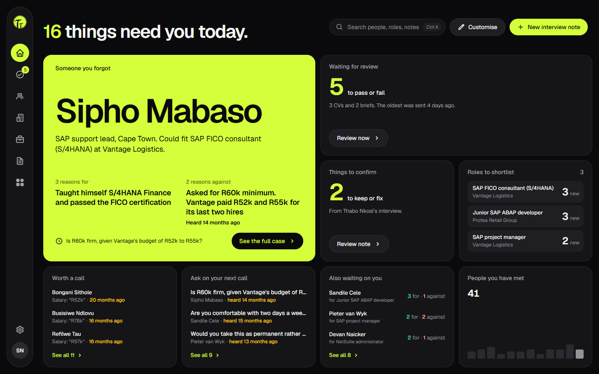
</p>

> All data in this repository and in the live demo is **synthetic**. No real candidate, recruiter or company data is used.

<details>
  <summary><strong>Table of contents</strong></summary>

1. [About the project](#about-the-project)
   - [The problem](#the-problem)
   - [What Tacit does](#what-tacit-does)
   - [Main features](#main-features)
   - [Design principles](#design-principles)
2. [Built with](#built-with)
3. [Architecture](#architecture)
4. [Getting started](#getting-started)
   - [Try the live demo](#try-the-live-demo)
   - [Prerequisites](#prerequisites)
   - [1. Frontend and backend](#1-install-the-frontend-and-backend)
   - [2. Database: set up Firebase](#2-set-up-the-database-firebase)
   - [3. Configure the environment](#3-configure-the-environment)
   - [4. Seed and run](#4-seed-the-data-and-run)
5. [Usage](#usage)
6. [Testing](#testing)
7. [Deployment](#deployment)
8. [Design: mockups and visuals](#design-mockups-and-visuals)
9. [Responsible AI and privacy](#responsible-ai-and-privacy)
10. [Roadmap and known limitations](#roadmap-and-known-limitations)
11. [Troubleshooting](#troubleshooting)
12. [References](#references)
13. [Acknowledgements](#acknowledgements)
14. [Author](#author)

</details>

---

## About the project

### The problem

The structured interview is one of the most predictive signals in hiring. What a recruiter learns there (how someone
works, what they want next, what they undersell, why they really left) doesn't fit a form, so it ends up as shorthand in
a paper notebook. Memory of it fades fast. Months later a role arrives and the recruiter fills it from whoever is top of
mind, not from everyone they have met.

That is a **memory-decay problem, not a screening problem**, and Tacit is built around that distinction. It was designed
with a specialist IT recruiter in South Africa, who described losing placements because the right person was already in
her CV folder and nobody remembered them in time.

### What Tacit does

1. **Capture.** The recruiter types interview notes as free text, under their own question headings. The note is saved
   first; then a language model turns it into structured attributes (skills, salary, notice period, motivation, reasons
   for leaving…). Every attribute is underlined in the note, so the recruiter can see exactly which sentence it came
   from, and keep or fix it.
2. **Recall.** When a brief arrives (pasted from an email, uploaded as a PDF or Word file, or typed during a call), Tacit
   reads it in the recruiter's own screening order and works back through **everyone they have ever met**. Each
   suggestion argues both sides: reasons for, reasons against, which requirements are evidenced and which are not, and
   what to ask before shortlisting.
3. **Remember.** Salary and availability go stale. Tacit shows the age of each perishable fact on that fact, flags
   people the recruiter has not opened in months, and records every override with the recruiter's own reason.

### Main features

**Recruiter app**

| Feature | What it gives the recruiter |
|---|---|
| **Customisable dashboard** | A bento board of widgets: *Someone you forgot*, roles to shortlist, things to confirm, people worth a call, questions for the next call. Drag to rearrange, resize, show or hide. |
| **Interview note capture** | Free-text notes with a question guide. The AI reads the note in seconds and lists *What Tacit heard*, each item linked to its exact phrase. Nothing is stored until the recruiter keeps it. |
| **Candidate profiles** | Facts grouped by type, each citing its source sentence and date; staleness shown on the specific fact that has aged; full interview history; CV view and download. |
| **CV upload** | Drop a whole CV folder (PDF, DOCX). Each file is parsed into comparable fields with a confidence flag. |
| **Brief intake** | Paste an email, upload a spec (PDF, DOCX, .eml, .msg) or type call notes. The AI extracts work mode, travel, budget, location, must-haves and seniority, each with the brief's own wording as proof. |
| **Match view** | Ranked suggestions with reasons for *and* against, skill alignment (stated, interpreted or not seen), evidence age, and questions to ask. No scores, no percentages. |
| **Overrides** | Shortlist or *Not this one*, always with a reason, plus "anything new?" fields that refresh stale salary or notice. Overrides teach the company profile what the client rejects. |
| **Search by meaning** | Ctrl K command palette and a search that finds people by meaning, not keywords, and says why each one matched. |
| **Companies and roles** | Company profiles with hiring history, placements and learned preferences; roles that open, fill or expire while the company persists. |
| **Review queue** | Every CV or brief sent through the portals waits here until the recruiter passes it or says why not. |
| **Settings** | Dark, light or system theme; reduced motion; POPIA retention period and per-candidate data export; AI connection status. |

**Candidate portal**: sign up, upload a CV, review exactly what was sent, keep salary and notice up to date, and follow
an **anonymised** role through shortlisted → interviewing → outcome. Candidates never see recruiter notes, other
candidates, or which company the role is at.

**Company portal**: invite-only. Send a brief, review an anonymous shortlist (each person with reasons for and against),
and move people to interviewing, hired or not progressing. A candidate's name and contact appear only once the company
moves them to interviewing.

### Design principles

These come from POPIA s.71 and the EU AI Act's treatment of hiring AI as high-risk. They are enforced in code, not just
in copy:

- **The recruiter decides.** Nothing is auto-rejected, auto-shortlisted or silently filtered out.
- **Two-sided reasoning.** Every suggestion shows reasons for *and* against. No bare scores.
- **Provenance.** Every AI-derived fact links to the exact span of the note it came from. Uncited claims are dropped.
- **Staleness is visible** on the specific fact that has aged.
- **The recruiter's words survive every failure.** A note is saved before the AI runs; an AI failure never loses it.
- **Nothing unvalidated is stored.** Model output passes a strict JSON schema and Zod validation first.
- **No demographic, name-derived or photo signal** is extracted, stored or used in matching.
- **No API key in the browser.** The model is reached only through the server.

<p align="right">(<a href="#readme-top">back to top</a>)</p>

## Built with

| Layer | Technologies |
|---|---|
| **Frontend** | [React 19](https://react.dev), [TypeScript](https://www.typescriptlang.org), [Vite](https://vite.dev), [React Router 7](https://reactrouter.com), [TanStack Query](https://tanstack.com/query), [dnd-kit](https://dndkit.com) (dashboard drag and drop), [Boxicons](https://boxicons.com), [Geist](https://vercel.com/font) font. Plain CSS with design tokens (`web/src/styles/tokens.css`) for dark and light themes. |
| **Backend** | [Node.js 22](https://nodejs.org), [Express 5](https://expressjs.com), [Firebase Admin SDK](https://firebase.google.com/docs/admin/setup); file reading with [unpdf](https://github.com/unjs/unpdf), [mammoth](https://github.com/mwilliamson/mammoth.js) (DOCX), [mailparser](https://nodemailer.com/extras/mailparser/) (.eml) and [msgreader](https://github.com/HiraokaHyperTools/msgreader) (.msg). Deployed as a [Cloud Function (2nd gen)](https://firebase.google.com/docs/functions). |
| **Database and auth** | [Cloud Firestore](https://firebase.google.com/docs/firestore), [Firebase Authentication](https://firebase.google.com/docs/auth) (email and password, custom role claims), [Cloud Storage for Firebase](https://firebase.google.com/docs/storage) (CVs and briefs), Firestore and Storage security rules. |
| **AI services** | [Groq](https://groq.com) running OpenAI's open-weight model [`gpt-oss-120b`](https://openai.com/index/introducing-gpt-oss/), called through Groq's OpenAI-compatible API with the [`openai`](https://github.com/openai/openai-node) SDK and **strict [Structured Outputs](https://console.groq.com/docs/structured-outputs)**. Every response is re-validated with [Zod 4](https://zod.dev). The provider is one adapter, so any OpenAI-compatible endpoint is an environment change. |
| **Shared** | An npm workspace (`shared/`) of Zod schemas used by both sides: one schema gives the TypeScript type, the JSON Schema sent to the model, and the runtime validator. |
| **Testing and tooling** | [Vitest](https://vitest.dev), [Testing Library](https://testing-library.com), [Supertest](https://github.com/ladjs/supertest), [Firebase Emulator Suite](https://firebase.google.com/docs/emulator-suite) (rules tests), [Playwright](https://playwright.dev) (screenshots), ESLint, a custom design-token check, an AI evaluation harness (`evals/`), Docker. |
| **Hosting** | [Hostinger](https://www.hostinger.com) (static web app), Firebase project in `africa-south1` (Johannesburg). |
| **Design** | [Figma](https://www.figma.com) (every screen was designed there first, in dark and light). |

### What the AI does

| Endpoint | Job | Prompt |
|---|---|---|
| `POST /api/interpret-note` | Messy interview note → attributes, each with the character span it came from | `interpret-note.v1` |
| `POST /api/parse-cv` | CV text → comparable candidate fields and a parse confidence | `parse-cv.v2` |
| `POST /api/parse-brief` | Brief (email, file or call notes) → requirements in screening order, each with a verbatim quote | `parse-brief.v2` |
| `POST /api/match` | Role → ranked candidates with reasons for and against, skill alignment and questions to ask | `match.v2` |
| `POST /api/search` | Free-text query → people found by meaning, each with why they matched | `search.v1` |
| `POST /api/courses/:id` | Course suggestions for a candidate long in the pool, checked by the recruiter before the candidate sees them | `course-suggest.v1` |

Prompts live in [`server/src/ai/prompts/`](server/src/ai/prompts). Every AI-written record stores
`modelVersion = <model>/<prompt version>`, so any output can be traced to the configuration that produced it.

<p align="right">(<a href="#readme-top">back to top</a>)</p>

## Architecture

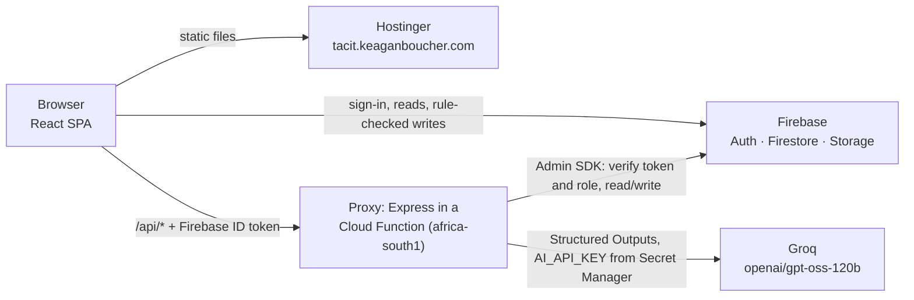

The browser never holds a model key. Every model call goes through the proxy, which verifies the Firebase ID token and
the caller's role (recruiter, candidate or company), and validates the model's output against the shared Zod schemas
before anything is stored. Firestore and Storage rules enforce the same roles for the reads and writes the browser makes
directly.

**How a note becomes evidence** (the recruiter's words are saved before the AI is asked anything):

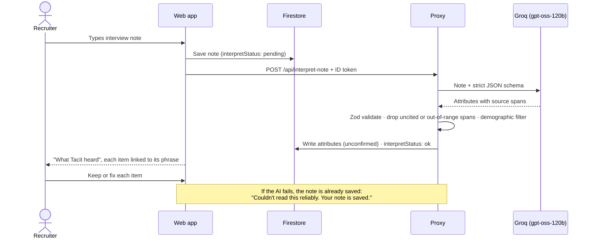

**Core data model** (simplified; every document also carries the owning recruiter's id and timestamps):

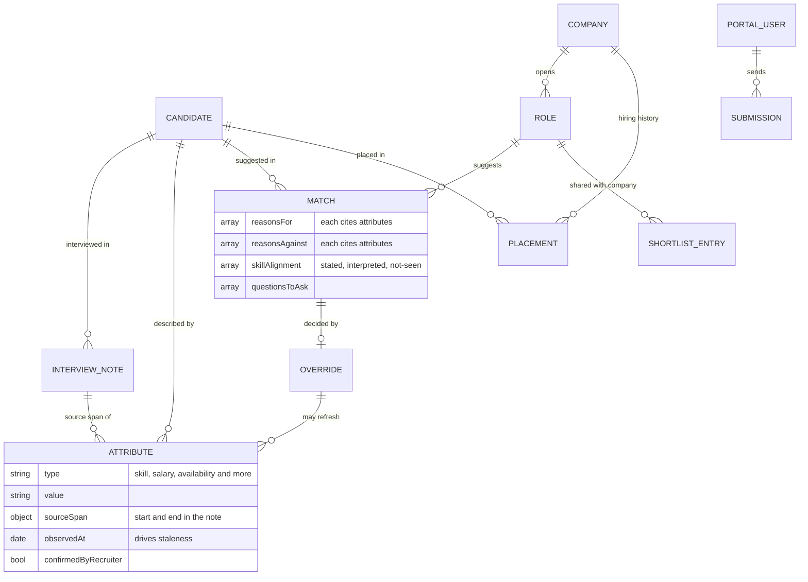

### Repository layout

```
tacit/
├── web/          React + Vite single-page app (screens, components, design tokens)
├── server/       Express proxy: auth, AI calls, file parsing, portal endpoints
│   └── src/ai/prompts/   Versioned prompts
├── shared/       Zod schemas and types used by web and server
├── functions/    Cloud Function package (the server, bundled by esbuild at deploy time)
├── scripts/      Seed data, role assignment, design-token check
├── evals/        AI evaluation harness: hand-written notes and expected attributes
├── tests/rules/  Firestore and Storage security-rules tests (emulator)
├── docs/         README screenshots
├── firestore.rules · storage.rules · firestore.indexes.json · firebase.json
└── Dockerfile · compose.yaml
```

<p align="right">(<a href="#readme-top">back to top</a>)</p>

## Getting started

### Try the live demo

The quickest way to see Tacit is the deployed app: **<https://tacit.keaganboucher.com>**.

Sign in on one of three doors:

| Role | Sign-in page |
|---|---|
| Recruiter | <https://tacit.keaganboucher.com/login> |
| Company | <https://tacit.keaganboucher.com/company/login> |
| Candidate | <https://tacit.keaganboucher.com/candidate/login> (or sign up at `/candidate/signup`) |

Demo logins for the recruiter and company accounts are not published in this repository; they are supplied with the
project submission or on request from the author. Anyone can create a candidate account; it waits in the recruiter's
review queue, as a real one would.

### Prerequisites

To run your own copy you need:

- **Node.js 22** and **npm 10** (or **Docker Desktop** instead of a local Node install)
- A **Firebase project** on the Blaze (pay-as-you-go) plan, which Storage and Cloud Functions require. The free monthly
  allowance covers a demo.
- A **Groq API key** from <https://console.groq.com/keys> (any OpenAI-compatible endpoint that supports strict Structured
  Outputs also works)
- **Java 17+**, only if you want to run the security-rules tests in the Firebase emulator

### 1. Install the frontend and backend

The repo is an npm workspace, so one install covers the web app, the server and the shared schemas.

```bash
git clone https://github.com/Keagan-Boucher/Tacit-Recruitment-Dashboard.git
cd Tacit-Recruitment-Dashboard
npm install
```

### 2. Set up the database (Firebase)

1. In the [Firebase console](https://console.firebase.google.com), create a project and add a **Web app**. Keep its
   config values for step 3.
2. **Authentication** → Sign-in method → enable **Email/Password**.
3. **Firestore Database** → create a database (production mode). **Storage** → get started.
4. Deploy the security rules and indexes from this repo to your project:

   ```bash
   npx -y firebase-tools@13.35.1 login
   npx -y firebase-tools@13.35.1 deploy --only firestore:rules,firestore:indexes,storage --project <your-project-id>
   ```

5. **Project settings** → Service accounts → **Generate new private key**. Save the file as
   `server/service-account.json` (git-ignored).
6. **Authentication** → Users → add three accounts (any email and password you like): a recruiter, a candidate and a
   company user. Then give each one its role:

   ```bash
   npm run set-role -- recruiter@example.com recruiter
   npm run set-role -- candidate@example.com candidate cand_demo_lerato
   npm run set-role -- company@example.com company co_demo_vantage
   ```

   `cand_demo_lerato` and `co_demo_vantage` are the seeded candidate and company these logins belong to.

### 3. Configure the environment

Copy each example file and fill it in. None of these files are committed.

| File | Copy from | Fill in |
|---|---|---|
| `web/.env.local` | `web/.env.example` | The Firebase web config (`VITE_FIREBASE_*`) and `VITE_API_BASE_URL=http://localhost:8787` |
| `server/.env` | `server/.env.example` | `ALLOWED_ORIGIN=http://localhost:5173` · `FIREBASE_SERVICE_ACCOUNT_PATH=./service-account.json` · `FIREBASE_STORAGE_BUCKET` (same as the web config) · `RECRUITER_UID` (the recruiter account's uid, from Authentication → Users) · `AI_BASE_URL=https://api.groq.com/openai/v1` · `AI_MODEL=openai/gpt-oss-120b` · `AI_API_KEY=<your Groq key>` · `ALLOWED_UIDS` (optional) |
| `.env.snap` | (create it) | `SNAP_EMAIL` / `SNAP_PASSWORD` for the recruiter, `SNAP_CANDIDATE_EMAIL` / `SNAP_CANDIDATE_PASSWORD` and `SNAP_COMPANY_EMAIL` / `SNAP_COMPANY_PASSWORD` for the portal accounts. The seed and screenshot scripts read it. |

Without `AI_API_KEY` the app still runs, but anything that calls the model shows its "couldn't read this" state, and your
notes are still saved.

The CV download button reads files straight from Storage, so the bucket needs a CORS rule that allows `GET` from
`http://localhost:5173`. Set it once with [`gsutil cors set`](https://cloud.google.com/storage/docs/using-cors) or the
Admin SDK's `bucket.setCorsConfiguration()`.

### 4. Seed the data and run

```bash
npm run seed   # loads the synthetic dataset: 41 candidates, 90 notes, 8 companies, 12 roles, CV PDFs, portal data
npm start      # web app on http://localhost:5173 and the proxy on http://localhost:8787
```

Open <http://localhost:5173> and sign in as the recruiter. <http://localhost:8787/api/health> should report
`"modelConfigured": true`.

<details>
<summary><strong>Prefer Docker?</strong> (nothing to install except Docker Desktop)</summary>

Create the secret files from steps 2 and 3 first, then from the repo root:

```bash
docker compose up
```

The first run builds the image and installs every dependency (a few minutes). Your code is mounted into the container,
so saving a file hot-reloads the app. Other commands run in the same container:

```bash
docker compose run --rm dev npm run check     # typecheck + lint + token check + unit tests
docker compose exec dev npm run seed          # (re)load the synthetic dataset
docker compose up --build                     # after a package.json / lockfile change
docker compose logs -f                        # follow the logs of a background run
```

</details>

| Command | What it does |
|---|---|
| `npm start` / `npm run dev` | Web (:5173) and proxy (:8787) together; `npm run dev -w web` or `-w server` for one half |
| `npm run seed` | Reset and reload the synthetic dataset (wipes the recruiter's documents first) |
| `npm run set-role -- <email> <role> [id]` | Give an account the recruiter, candidate or company role |
| `npm run check` | Typecheck, lint, design-token check and all unit tests |
| `npm run test:rules` | Firestore and Storage rules tests in the emulator (needs Java 17+) |
| `npm run eval` | Score the AI against hand-written notes in `evals/` (calls Groq; costs a fraction of a cent) |
| `npm run build -w web` | Production build of the web app into `web/dist` |
| `npm run build:functions` | Bundle the server into `functions/` for deployment |

<p align="right">(<a href="#readme-top">back to top</a>)</p>

## Usage

The seeded data tells one story you can follow end to end: **Sipho Mabaso**, an SAP support lead interviewed 14 months
ago for an unrelated role, quietly taught himself S/4HANA Finance and passed the FICO certification. Today a brief
arrives from **Vantage Logistics** for an *SAP FICO consultant (S/4HANA)*. Tacit should surface him, with the case for
and the case against.

### As the recruiter

**1. Start on the dashboard.** The headline counts what needs you today. *Someone you forgot* puts Sipho front and
centre, with his strongest reason for and against and the question to ask first. Press **Customise** to drag, resize or
hide widgets.

**2. Capture an interview.** Open a candidate and choose **New interview note** (or use the dashboard button). Type
freely; the question guide chips insert your standard headings. Within seconds *What Tacit heard* lists what the AI
understood. Each item is underlined in your note. **Keep** what is right, **Fix** what isn't, or **Save note only**.

<p align="center">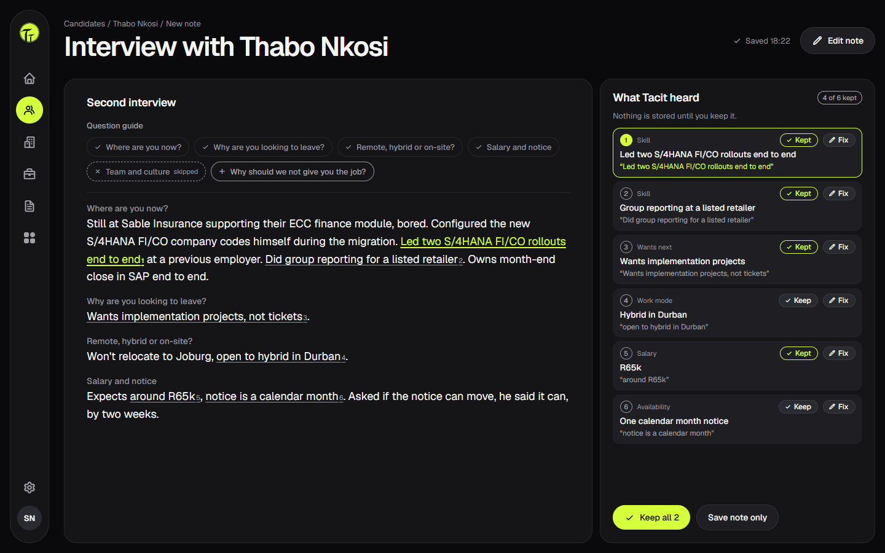</p>

**3. Check a candidate's evidence.** On a profile, every fact shows where it came from and when. Click one and the exact
phrase lights up in the original note. Ageing salary and notice facts show their age in amber.

<p align="center">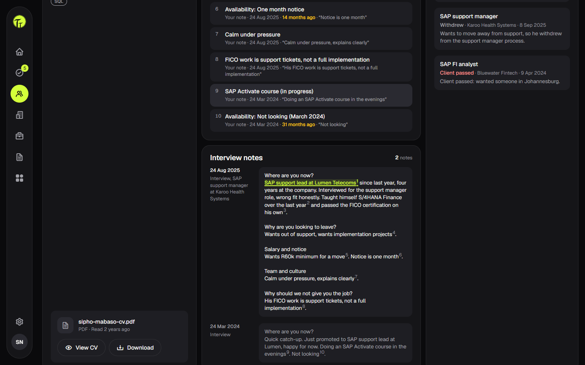</p>

**4. Bring in a brief.** Go to **Brief** in the side rail. Paste the client's email, upload the spec, or type notes from
the call. Tacit reads it in the order you screen (work mode, travel, budget, location, must-haves, seniority) and quotes
the brief for each field. It then shows who is worth a look from everyone you have met.

<p align="center">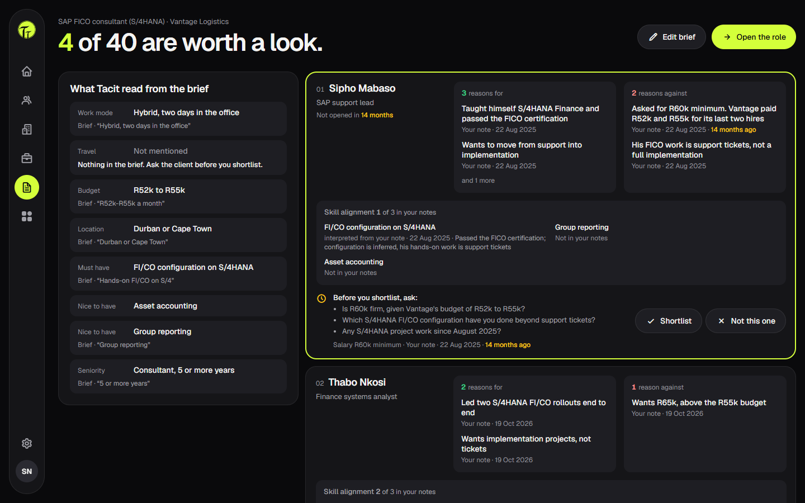</p>

**5. Decide on the match view.** Open the role. Each suggestion gives reasons for and against (each linked to its
source), skill alignment marked *stated*, *interpreted* or *not in your notes*, and the questions to ask before you
shortlist. Choose **Shortlist** or **Not this one**. Either way you record why, and can note a new salary or notice
period that refreshes the stale fact.

<p align="center">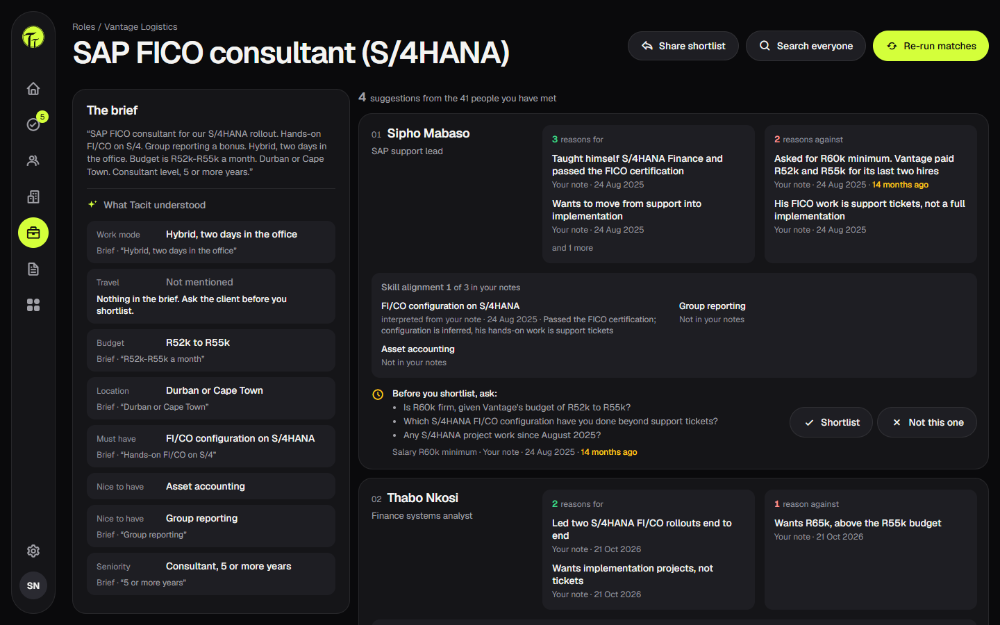</p>

**6. Share with the client and work the queue.** **Share shortlist** sends an anonymous version to the company portal.
CVs and briefs that arrive through the portals wait in **Review** until you pass them or give a reason for not accepting.
The sender sees that reason.

<p align="center">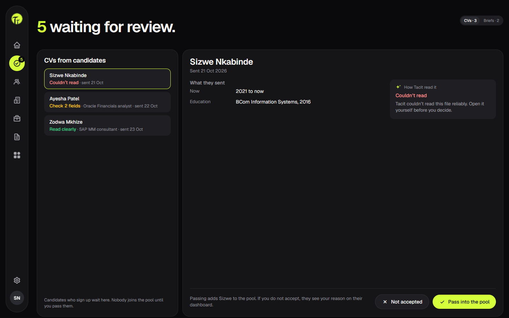</p>

Other places to explore: **Candidates** (list, filters, CV upload), **Companies** (hiring history and what each client
has rejected and why), **Roles**, **Widgets**, **Settings** (theme, reduced motion, POPIA retention, data export), and
**Ctrl K** to jump anywhere or search by meaning.

### As a company (client)

Sign in at `/company/login` (companies join by the recruiter's invite link). **Your roles** lists every role and its
shortlist. Each shortlisted person is anonymous (*Candidate B*) with a headline, key facts and reasons for and against.
Choose **Move to interviewing** to reveal their name and contact, then **Mark as hired** or **Not progressing** (with a
reason). **Send a brief** submits a new role for the recruiter to review.

<p align="center">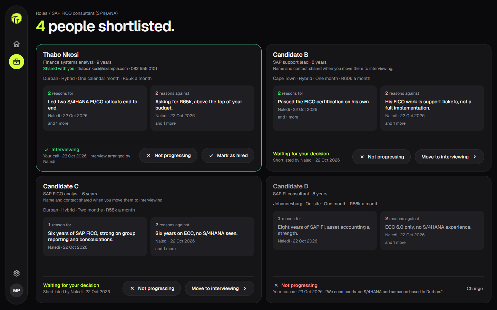</p>

### As a candidate

Sign up at `/candidate/signup`, then **Upload your CV**. Check what Tacit read before you send it. Once the recruiter
accepts it you're in the pool. The home page shows any role you've been put forward for (the company stays anonymous until
you agree to interview), your recruiter's contact details, and a prompt to keep your salary, notice and work mode fresh.
**My details** shows everything you sent and lets you request a copy of your data.

<p align="center">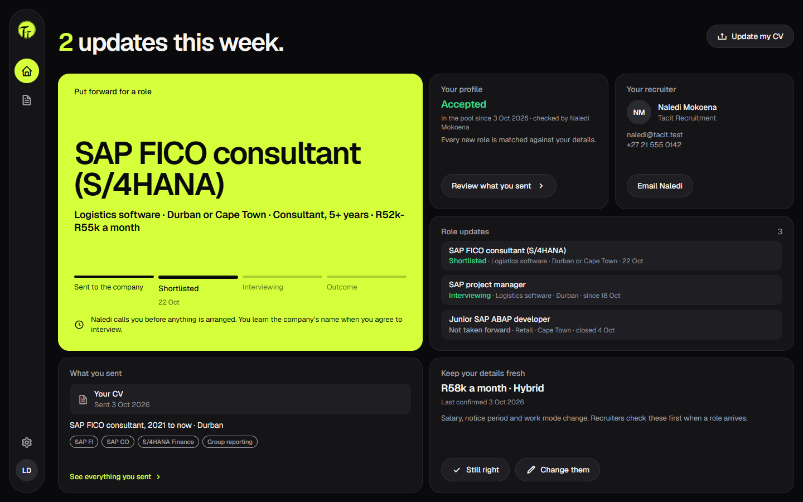</p>

<p align="right">(<a href="#readme-top">back to top</a>)</p>

## Testing

```bash
npm run check        # typecheck, lint, design-token check, ~590 unit tests across web, server and shared
npm run test:rules   # security rules in the Firebase emulator: who can read and write what, per role
npm run eval         # AI quality: precision and recall per attribute type, and every source span checked
```

The unit tests cover the proxy routes (auth, roles, validation, AI failure paths), the schemas, and the screens with
Testing Library. The rules tests prove the portal privacy rules at the database: a company cannot read candidates, and a
candidate cannot read companies or recruiter notes. `EVAL_FAKE=1 npm run eval` dry-runs the harness without calling the
model.

Before the build was signed off, the deployed app was audited against every principle in
[Design principles](#design-principles), on the live site and for all three roles, and given a security review.
The audit checked the network traffic as well as the screens.

<p align="right">(<a href="#readme-top">back to top</a>)</p>

## Deployment

Production is one Firebase project (Blaze plan). The web app is static files on Hostinger; the proxy is the same Express
app wrapped as a 2nd-gen Cloud Function (`server/src/function.ts`, bundled into `functions/` by
`npm run build:functions`).

**Proxy (Cloud Function `api`).** Copy `functions/.env.example` to `functions/.env.<project-id>` and fill it in (the
bucket variable is `STORAGE_BUCKET`, because Functions reserves the `FIREBASE_` prefix). Then:

```bash
npx -y firebase-tools@15.34.1 login
npx -y firebase-tools@15.34.1 functions:secrets:set AI_API_KEY --project <project-id>
npx -y firebase-tools@15.34.1 deploy --only functions --project <project-id>
```

The secret is set once; later deploys only need the last command (it builds the bundle first). Use firebase-tools 15.x
for functions: 13.x cannot load firebase-functions 7. Check it with `curl <function-url>/api/health`.

**Web (Hostinger or any static host).** Create `web/.env.production.local` with
`VITE_API_BASE_URL=<function-url>` (the `VITE_FIREBASE_*` values come from `web/.env.local`), then:

```bash
npm run build -w web
```

Upload the contents of `web/dist`, including the hidden `.htaccess` (deep-link fallback, https redirect, caching), to the
site's document root. If you zip it on Windows, use `tar -a -cf dist.zip -C web/dist .htaccess assets favicon.svg fonts index.html`.
PowerShell 5's `Compress-Archive` writes backslash paths that break on Linux hosts.

**For each new web domain:** add it to Firebase Authentication → Authorized domains and to the Storage bucket's CORS rule.
Set `ALLOWED_ORIGIN` in the functions env file, then redeploy the function.

**Before a demo:** `npm run seed` resets the data. Opening a candidate clears their "forgotten" flag, so reseed between
runs.

<p align="right">(<a href="#readme-top">back to top</a>)</p>

## Design: mockups and visuals

Every screen (18 recruiter screens, 5 company and 4 candidate portal screens, and their loading, empty and error states)
was designed in Figma first, in dark and light, and then built to match. Build screenshots were compared side by side with
the Figma frames.

| Figma mockup | Built app (light theme) |
|---|---|
| 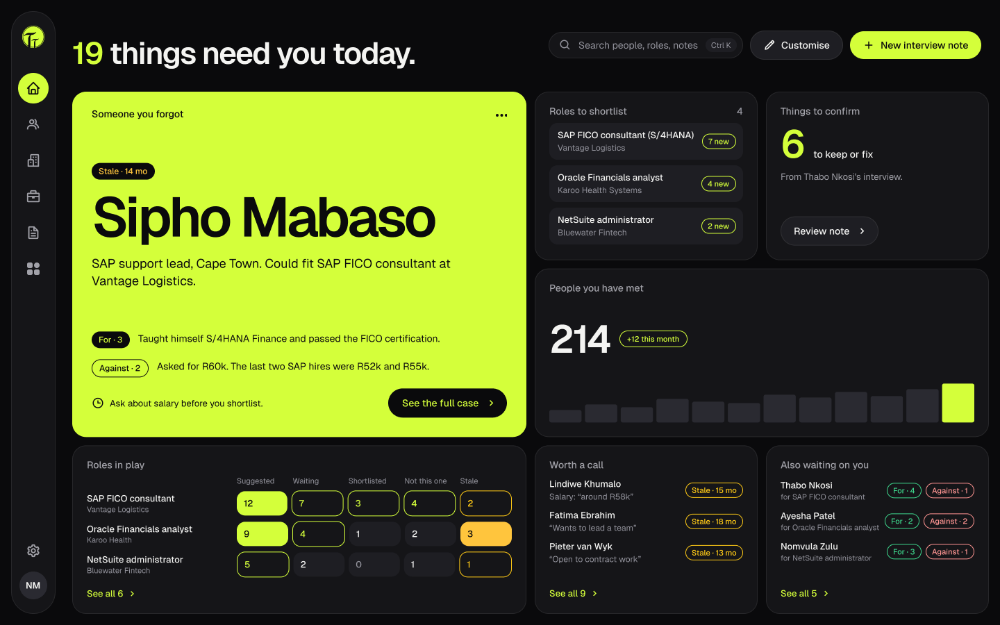 | 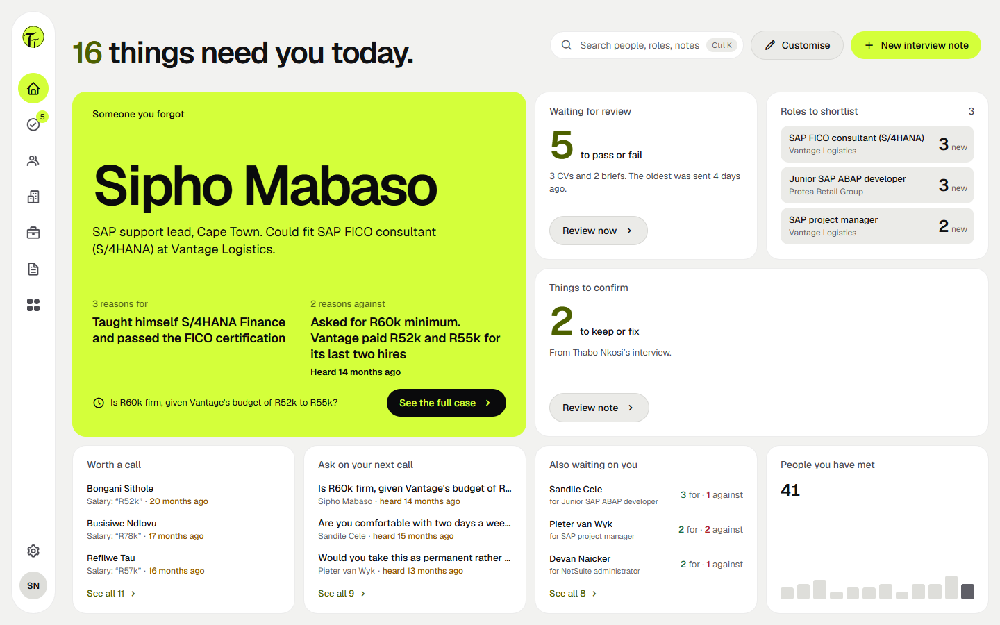 |

The visual language is a dark-first bento grid with a single lime accent, set in Geist. Colour, type, radius and spacing
all come from design tokens, so dark and light themes share every component. A token check in `npm run check` fails the
build if a component hard-codes a colour. Status colours are never the only signal (text always accompanies them), and the
app respects reduced-motion settings.

<p align="right">(<a href="#readme-top">back to top</a>)</p>

## Responsible AI and privacy

- **Human in the loop by design.** POPIA s.71 prohibits decisions with substantial effect based *solely* on automated
  processing, and the EU AI Act classes recruitment AI as high-risk (Annex III). Tacit only suggests; the recruiter
  confirms every extracted fact and every shortlist, and every disagreement is recorded with a reason.
- **Explainable by construction.** The schemas make uncited claims invalid: a reason without the attributes it rests on
  is rejected before storage, and every attribute carries the character span of the note it came from.
- **No proxies for protected traits.** No field exists for gender, age, ethnicity, nationality or photos. Prompts forbid
  such signals, and a server-side filter drops any output that mentions them.
- **Portals see only their side.** Rules and server code (not just the UI) keep candidate identity from companies until
  interviewing, and company identity and recruiter notes from candidates.
- **Data subject rights.** Settings set a retention period and export everything held about a candidate; candidates can
  request a copy of their data from the portal.
- **Synthetic data only.** Every person, company and CV in the seed is invented.

<p align="right">(<a href="#readme-top">back to top</a>)</p>

## Roadmap and known limitations

- [x] Recruiter app: capture, recall, match, override, review queue
- [x] Candidate and company portals
- [x] Deployed: Hostinger + Firebase Cloud Functions (africa-south1)
- [ ] Security hardening before any real candidate data: per-account rate limits on portal uploads, stricter Storage
      file-type rules, email verification on company invites, security headers
- [ ] The recruiter's real interview question guide (the seed ships a draft)
- [ ] Unassisted usability study with recruiters
- [ ] Nice to have: staleness digest, candidate timeline across years, voice capture

This is an MVP for one recruiter. Team accounts, ATS integrations, job-board ingestion and candidate-to-company
messaging are deliberately out of scope.

<p align="right">(<a href="#readme-top">back to top</a>)</p>

## Troubleshooting

- **Port already in use:** something else holds 5173 or 8787. Stop it, or change the left side of the port mapping in
  `compose.yaml`.
- **After signing in you land on the candidate "finish signing up" page:** the account has no role yet. Run
  `npm run set-role` (step 2.6), then sign out and in again so the new role reaches the token.
- **"Couldn't read this" on every note:** check `AI_API_KEY` in `server/.env` and that `/api/health` reports
  `"modelConfigured": true`.
- **Groq `429`:** you hit the account's per-minute token cap. Wait a minute and retry; the note is already saved.
- **Download CV fails in the browser:** the Storage bucket needs a CORS rule for your origin (step 3).
- **`npm install` ran on your laptop and Docker misbehaves:** run `docker compose down -v`, then `docker compose up --build`.
- **Saves don't hot-reload in Docker:** file watching uses polling (set in `compose.yaml`). Check that Docker Desktop
  shares the repo's drive.
- **Docker Desktop won't start on Windows** ("sailor-ingest.sock"): quit it from the tray, delete the files in
  `%LOCALAPPDATA%\Docker\run`, then start it again.

<p align="right">(<a href="#readme-top">back to top</a>)</p>

## References

**Research behind the product**

1. Schmidt, F. L., & Hunter, J. E. (1998). The validity and utility of selection methods in personnel psychology:
   Practical and theoretical implications of 85 years of research findings. *Psychological Bulletin, 124*(2), 262–274.
   <https://doi.org/10.1037/0033-2909.124.2.262>
2. Murre, J. M. J., & Dros, J. (2015). Replication and analysis of Ebbinghaus' forgetting curve. *PLOS ONE, 10*(7),
   e0120644. <https://doi.org/10.1371/journal.pone.0120644>
3. Republic of South Africa. (2013). *Protection of Personal Information Act 4 of 2013* (POPIA), section 71: automated
   decision making. <https://popia.co.za/section-71-automated-decision-making/>
4. European Union. (2024). *Regulation (EU) 2024/1689 (Artificial Intelligence Act)*, Annex III: high-risk AI systems,
   point 4 (employment). <https://eur-lex.europa.eu/eli/reg/2024/1689/oj>

**Technical documentation**

5. Groq. *Structured Outputs*. <https://console.groq.com/docs/structured-outputs>
6. OpenAI. (2025). *Introducing gpt-oss*. <https://openai.com/index/introducing-gpt-oss/>
7. Google. *Firebase documentation*: Authentication, Cloud Firestore, Cloud Storage, Cloud Functions, security rules.
   <https://firebase.google.com/docs>
8. Zod. *JSON Schema* (Zod 4). <https://zod.dev/json-schema>
9. React, Vite and React Router documentation: <https://react.dev>, <https://vite.dev>, <https://reactrouter.com>

**README**

10. Othneil Drew. *Best-README-Template*. <https://github.com/othneildrew/Best-README-Template> (structure of this file)

<p align="right">(<a href="#readme-top">back to top</a>)</p>

## Acknowledgements

- **Vanessa Boucher** (Breakwaters), for the contextual interview and prototype walkthrough that shaped the screening
  order, the question guide, and the trust conditions behind two-sided reasoning.
- [Geist](https://vercel.com/font) by Vercel, used under the SIL Open Font License (`web/public/fonts/Geist-LICENSE.txt`).
- [Boxicons](https://boxicons.com) for the icon set.
- [dnd-kit](https://dndkit.com), [TanStack Query](https://tanstack.com/query), [Zod](https://zod.dev),
  [unpdf](https://github.com/unjs/unpdf), [mammoth.js](https://github.com/mwilliamson/mammoth.js),
  [mailparser](https://nodemailer.com/extras/mailparser/) and [msgreader](https://github.com/HiraokaHyperTools/msgreader)
  for the open-source libraries this is built on.
- [Groq](https://groq.com) for model hosting, and OpenAI for the open-weight `gpt-oss-120b` model.
- [Shields.io](https://shields.io) for the badges.
- Development was assisted by [Claude Code](https://claude.com/claude-code) (Anthropic), used for implementation,
  testing and review under the author's direction. Product research, design and all decisions are the author's.

<p align="right">(<a href="#readme-top">back to top</a>)</p>

## Author

**Keagan Boucher**: [github.com/Keagan-Boucher](https://github.com/Keagan-Boucher) ·
[tacit.keaganboucher.com](https://tacit.keaganboucher.com)

Project repository: <https://github.com/Keagan-Boucher/Tacit-Recruitment-Dashboard>

<p align="right">(<a href="#readme-top">back to top</a>)</p>
